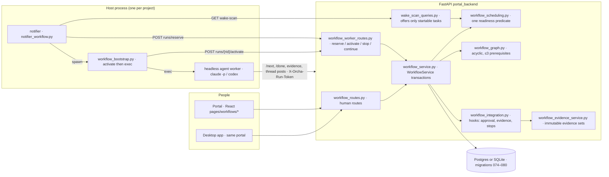
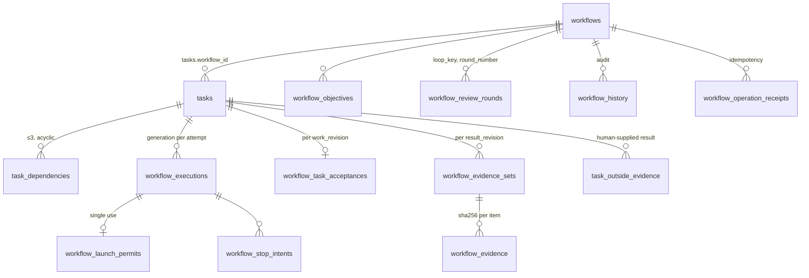
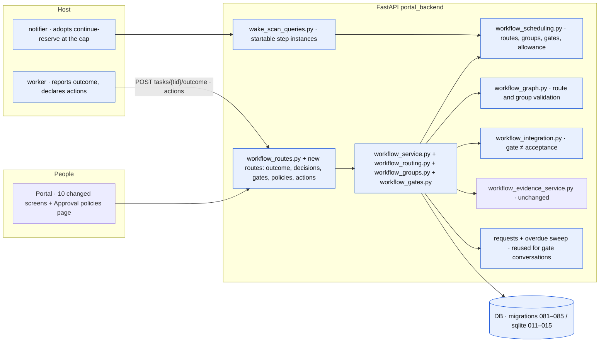
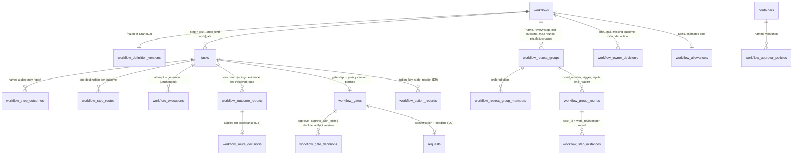
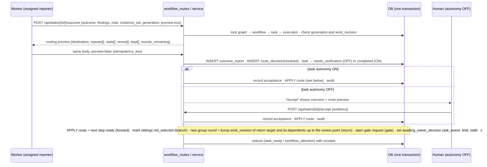
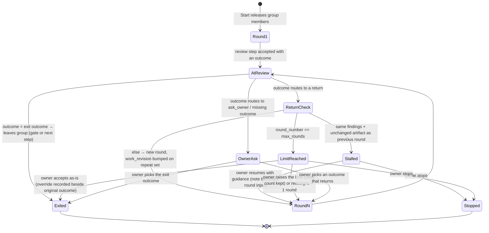
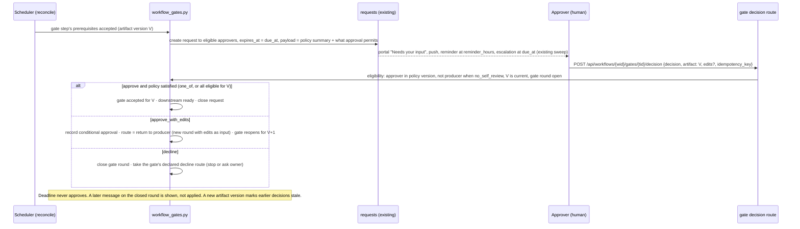
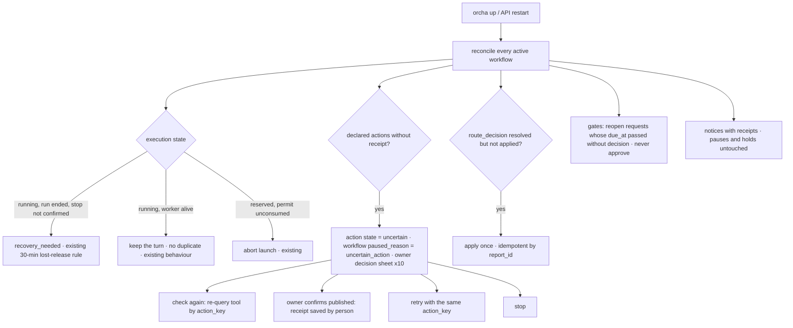

# Flexible Orcha workflows — high-level design

Prepared by CodeCleanupAgent for Kedar · Version 1 · 2026-10-28 (UTC) · Step 3 of the "Make workflows better" workflow

**Status: draft for Kedar's approval.** Published as [issue #363](https://github.com/open-orcha/orcha/issues/363); source folder `docs/design/workflows/flexible/architecture/` on branch `design/workflow-flexible-architecture`. The task runs with autonomy OFF: the plan was posted on the task thread for approval, and this draft was written in the same run so the plan and the document can be approved or redirected together. Nothing here is implemented; step 2 (ReleaseEngineer) builds and tests it after approval.

**Inputs, in order of authority:** the product requirements (Informer, version 1, attached to the requirements task; its plan is [issue #355](https://github.com/open-orcha/orcha/issues/355)); the UX design ([issue #362](https://github.com/open-orcha/orcha/issues/362), branch `design/workflow-flexible-ux`, README §7 lists six API asks); the approved market research ([issue #354](https://github.com/open-orcha/orcha/issues/354)); and the Workflows code on [PR #340](https://github.com/open-orcha/orcha/pull/340) (branch `orcha/task-CodeCleanupAgent-2799ac2b-37e`, head `8bd33350`), which is not on `main`. Every "today" statement below was checked against that branch on 2026-10-28.

Diagrams are Mermaid blocks (rendered on GitHub) with PNG renders in `diagrams/` for surfaces that do not render Mermaid.

---

## 0. Summary

Orcha Workflows today run a list of tasks in prerequisite order, with one special-cased loop (a reviewer's "changes requested" spawns a correction task and a re-review task, up to five rounds) and with every human decision expressed as task acceptance. The approved requirements ask for five new ideas: **declared outcomes with "what happens next" rules**, **bounded repeat groups** (rounds, a limit, stall detection, an escalation owner), **feedback carried into each round**, **reusable human approval policies** whose gates are separate from task acceptance, and **recovery that never repeats a public action**.

The design keeps everything that already makes Workflows safe (tasks as the unit of work, accepted prerequisites, execution generations and single-use launch permits, immutable evidence, human-only Start and Finish, one readiness predicate shared by preview, commit, scheduler and wake scan) and adds a thin **definition-and-run layer** on top:

- A **definition snapshot** is frozen at Start, so a running workflow keeps its meaning.
- A **step instance** is the pair (task, work revision); a new round of a step is a new work revision of the same task, not a new task. An **attempt** is an execution generation inside that revision. This maps onto the tables that already exist and keeps a three-step workflow three rows on screen.
- **Routes**, **repeat groups**, **gates**, **approval policies**, **outcome reports**, **owner decisions**, **turn allowances** and **outside-action receipts** are new tables, written in the same transaction as the task and execution changes they cause.
- Everything new sits behind a **workflow semantics version** (`1` = today, `2` = this design). Existing workflows never change meaning.

Section 4 lists, component by component, what changes and roughly how much. Section 5 answers the UX design's API asks with concrete routes and bodies. Section 9 lists the decisions Kedar must make.

---

## 1. Where we are: the Workflows engine on PR 340

### 1.1 Components today

Facts that constrain the design (all verified on the branch):

- **A step is a task.** `tasks.workflow_id`, `tasks.work_revision`, `preparation_state`, `start_hold`, `human_hold_by`, `awaiting_owner_decision` (migration 075). Assignment stays the `agent_tasks` join.
- **Prerequisites** live in `task_dependencies`; `workflow_graph.validate_graph` refuses cycles, self-edges, duplicates and more than three prerequisites, and the same pure function serves preview and commit.
- **Ready means accepted prerequisites.** `workflow_scheduling.accepted()` requires `status = completed`, an acceptance row for the task's current `work_revision`, valid evidence, and either a human actor or an AI actor with task autonomy ON at acceptance. `stored_status()` recomputes waiting states without clearing any hold or owner decision.
- **A turn is an execution.** `workflow_executions` carries `generation`, `work_revision`, `state` (reserved → running → awaiting_review → … → released), `source_kind` (worker, evidence_review, import_review). A single-use **launch permit** binds one run to one generation; **stop intents** are recorded before delivery; a worker whose stop is never confirmed can be released only after 30 quiet minutes (`release_deadline`). `reconcile()` marks executions `recovery_needed` when the run ended without a confirmed stop.
- **Evidence is immutable.** `workflow_evidence_sets` (one per task and result revision, frozen, sha256 per item) and `workflow_task_acceptances` (unique per task and work revision, recording actor kind, autonomy at acceptance and the exact evidence items).
- **Loops today** are `workflow_review_rounds` keyed by `loop_key`: `op_review_round` records an outcome (`changes_requested`, `accepted`, `inconclusive`) for a review task and, on changes requested, creates a **new correction task and a new review task** chained by prerequisites, until `round_limit` (default 5) or `task_limit` (50) sets `limit_reached`. The owner resolves an open loop with a reason.
- **Human authority.** Start, release, holds, retry, finish, cancel, transfer and goal or objective acceptance are owner-only (`WorkflowService.owner`). Task completion goes through `task_autonomy_service.record_approval` with autonomy OFF meaning a person accepts.
- **Idempotency and audit.** Every mutation carries `expected_revision` and `idempotency_key`; results are stored in `workflow_operation_receipts`; every action is written to `workflow_history`; `workflow_notification_receipts` keeps notices from repeating.
- **Worker admission.** The wake scan offers a workflow task only if the reserve route would accept it (`startable_task_ids`); events on a task that cannot start are parked. The notifier reserves a run, spawns the inert bootstrap, which activates the permit and then execs the agent. Legacy launch paths refuse workflow tasks. The 20-minute worker cap kills workflow workers without continuation ([#352](https://github.com/open-orcha/orcha/issues/352)); a `continue-reserve` API exists but no caller uses it yet.
- **The prompt** (`workflow_prompt.py`) gives the worker the workflow title, goal and every step's title, status, assignees and result text. There are no typed outputs.
- **Capability flag.** `WORKFLOWS_INTEGRATED` and `GET /api/containers/{cid}/workflows/capability` gate every write; the portal hides what the server does not report.

### 1.2 Data model today

### 1.3 Where today falls short of the requirements

| Requirement (PRD first release) | Gap on PR 340 | Evidence |
|---|---|---|
| Explicit outcomes and next-step rules | No outcome vocabulary, no routes, no reporter rule; the only branching is "accepted or not". | `schemas/workflows.py` has no outcome or route fields; `workflow_scheduling.stored_status` only checks accepted prerequisites. |
| Bounded repeat-until groups | Loops exist only as review-task pairs; each round is two new tasks; groups of many steps, a chosen review point, an exit outcome and an escalation owner do not exist. | `op_review_round` (service lines 2930–3060) creates `correction` + `next_review` tasks. |
| Feedback carried into each round | The prompt passes result text of earlier steps; no findings, no exact artifact versions, no reason for return. | `workflow_prompt.py`. |
| Stall detection and allowances | No comparison between rounds; limits are round count and task count only; no run-level turn allowance or cost. | `workflows.round_limit`, `task_limit`, `limit_reached`. |
| Approval policies and gates | Human authority is expressed only as task acceptance (`record_approval`, phase COMPLETION); no named policy, no eligible approver list, no deadline, no "what approval permits". | `workflow_integration.authorize_completion`. |
| Stable definition for running work | Revision counters exist; no snapshot of the step graph at Start; edits after Start are allowed by the dependency editor for never-started tasks. | `op_dependencies`, `never_started`. |
| Recovery without repeating a public action | Executions recover and workers are reconciled, but there is no record of an outside action (publish, send) and its receipt. | No table or route for actions; `reconcile()` only looks at runs. |
| Visible status and finish | Labels and blockers are server-computed and good; rounds, routes, gates and allowances cannot be shown because they do not exist. | `task_display`, `progress_and_completion`. |
| Worker continuation past the runtime cap | Not implemented; a release dependency per the PRD. | #352; `continue_turn` exists, no caller. |

---

## 2. Design decisions

| # | Decision | Why |
|---|---|---|
| D1 | **Extend the present engine; no external workflow service.** | The PRD prefers it; the execution, evidence and authority rules are already right and tested. A second engine would add a second authority boundary. |
| D2 | **A definition snapshot is frozen at Start** (`workflow_definition_versions`). Before Start the draft is editable; after Start only run controls change (holds, allowance, reassignment, owner decisions). Templates (next release) copy a version. | The PRD requires a run tied to its saved definition and policy versions. |
| D3 | **Step instance = (task, work revision); attempt = execution generation.** A new round bumps `work_revision` on the steps that must repeat, exactly as `op_retry` does today, and records the round. No new tasks per round. | Acceptances and evidence sets are already keyed by work revision, so a return automatically makes the old acceptance stale; the plan stays readable (Dana's bracket on three rows). |
| D4 | **Outcome ≠ authority.** A step's completion carries one declared outcome and findings. The route is *resolved* when the outcome is reported and *applied* when that step's work is accepted under its own authority rule (immediately with task autonomy ON; on the person's Accept with autonomy OFF). Gates are separate steps that only a policy's approvers can pass. | PRD: "An outcome describes the result, not permission to proceed"; "an explicit human gate must always require its authorized human decision". |
| D5 | **Routes and groups are layered on prerequisites, which stay acyclic.** A route may point forward (branch), to an earlier step *inside the same repeat group* (return), to "ask the owner" or to "exit the group". A return never adds a prerequisite edge; it starts a new round. | PRD: "A backward route must not simply disable cycle validation". |
| D6 | **One authoritative readiness predicate.** `workflow_eligibility` grows to understand routes, not-selected steps, group rounds, gates and allowances; preview, commit, wake scan and recovery keep calling the same function. | Already the pattern; keeps UI preview and server commit from disagreeing. |
| D7 | **Gates reuse Orcha requests for the human conversation.** A gate that opens creates an Orcha request to the eligible approvers with a deadline; reminders and escalation reuse the existing overdue-request sweep; the *decision* is recorded through a dedicated gate route bound to the artifact version. A plain "approved" reply to that request is treated as a decision only after confirmation. | Reuses tested machinery; matches "approval is a conversation, not a button" while keeping a structured record. |
| D8 | **Outcome, route decision, round state and schedule intent commit in one transaction**, under the existing lock order (container graph guard → workflow → task → execution), with the existing idempotency receipts. | PRD: a repeated event must not create another logical transition. |
| D9 | **Outside actions get a stable action key and a receipt.** The worker declares an action before performing it and stores the receipt after; a restart that finds a declared action without a receipt marks it *uncertain* and asks the owner. | PRD recovery requirement; Dana's frame x10. |
| D10 | **Semantics version per workflow.** `workflows.semantics_version` = 1 for every existing row; new workflows get 2 only when the capability is on. The portal hides version-2 controls on servers that do not report the capability. | Rollout and compatibility section of the PRD; Dana's §5. |

---

## 3. Target architecture

### 3.1 System context with the new pieces

Blue = changed in this design. Nothing is removed.

### 3.2 Definition, run, step instance, attempt

New tables (Postgres names; SQLite mirrors them as migrations 011–015):

| Table | Purpose | Key columns |
|---|---|---|
| `workflow_definition_versions` | Frozen definition per Start (later per template version). | `workflow_id`, `version`, `snapshot` JSONB (steps, outcomes, routes, groups, gates, allowance), `created_by`, `created_at` |
| `workflow_step_outcomes` | Outcome vocabulary per step. | `task_id`, `name` (≤40 chars), `kind` ∈ success · changes · failure · custom, `reporter` ∈ assignee · reviewer · human |
| `workflow_step_routes` | One destination per outcome. | `task_id`, `outcome_name`, `destination_kind` ∈ step · ask_owner · exit_group · stop, `destination_task_id`, `group_id` (required for a return) |
| `workflow_repeat_groups` / `_members` | Bounded groups. | `name`, `review_task_id`, `exit_outcome`, `max_rounds` (1–20, default 5), `escalation_owner_id`, `stall_rule` ∈ findings_and_artifact · off; members: `task_id`, `position` |
| `workflow_group_rounds` | One row per round of a group. | `round_number`, `trigger` ∈ initial · return · owner_resume · gate_edits, `return_from_task_id`, `return_to_task_id`, `reason`, `inputs` JSONB (artifact versions, finding ids, reviewer note), `stall` JSONB (compared rounds, unchanged findings), `end_reason` ∈ exit · return · limit · stall · stopped |
| `workflow_step_instances` | Which work revision of each step belongs to which round. | `task_id`, `work_revision`, `group_round_id`, `created_at` |
| `workflow_outcome_reports` | The declared result of an attempt. | `task_id`, `work_revision`, `generation`, `reporter_id`, `outcome_name`, `findings` JSONB [{id, text, severity}], `note`, `evidence_set_id`, `reported_at`; UNIQUE (task_id, work_revision) |
| `workflow_route_decisions` | The route resolved from a report and when it was applied. | `report_id`, `destination_kind`, `destination_task_id`, `group_round_id`, `preview` JSONB (repeats, stale, renew, kept), `resolved_at`, `applied_at`, `applied_by` (acceptance id), `overridden_by_decision_id` |
| `workflow_owner_decisions` | Every owner choice at a limit, stall, missing outcome, override or uncertain action. | `subject_kind`, `subject_id`, `options` JSONB, `chosen`, `reason`, `original_outcome`, `decided_by`, `decided_at` |
| `workflow_approval_policies` | Named, versioned, per project. | `name`, `version`, `approver_ids` JSONB (humans only), `rule` ∈ one_of · all, `no_self_review`, `deadline_hours`, `reminder_hours`, `escalation_owner_id`, `permits`, `lost_access_rule`, `superseded_by` |
| `workflow_gates` | A gate step's binding. | `task_id` (step_kind = gate), `policy_id`, `policy_version`, `permits`, `request_id` (the open conversation), `due_at` |
| `workflow_gate_decisions` | One decision per approver per gate round. | `gate_task_id`, `gate_round`, `artifact` JSONB (deliverable versions + sha256), `decision` ∈ approve · approve_with_edits · decline, `edits`, `decided_by`, `decided_at`, `stale` |
| `workflow_action_records` | Outside actions with stable keys. | `task_id`, `work_revision`, `action_key` (UUID handed to the tool), `kind`, `state` ∈ declared · succeeded · failed · uncertain · confirmed_by_owner, `receipt` JSONB, `declared_at`, `settled_at` |
| `workflow_allowances` | Run-level bounds. | `workflow_id`, `turn_allowance` (default 40), `turns_used` (maintained from executions), `estimated_cost_cents` nullable, `cost_source` |

Columns added to existing tables: `workflows.semantics_version` (1 default), `workflows.definition_version`, `workflows.paused_reason` (stalled · limit · uncertain_action · owner), `tasks.step_kind` (work · gate), `tasks.route_state` (selected · not_selected · null), `tasks.awaiting_owner_decision` gains `limit_reached`, `stalled`, `missing_outcome`, `uncertain_action`.

### 3.3 Readiness with routes, groups and gates

`workflow_eligibility` keeps every check in `_base_blockers` (they were each justified after the restart stranding bug) and adds, in this order:

1. **Not selected.** A step with `route_state = not_selected` never starts and is excluded from Finish. A prerequisite that is not selected is ignored when the dependent has at least one selected or accepted prerequisite; a step whose prerequisites are all not selected becomes not selected itself (propagated in the same transaction that recorded the route).
2. **Current round only.** A member of a repeat group may start only in the group's current round: its latest `workflow_step_instances` row must belong to the current `workflow_group_rounds` row. Steps outside any group are unaffected.
3. **Group paused.** If the group's current round ended with `limit` or `stall`, every member reports blocker `group_paused` with the owner named.
4. **Gate.** A gate step has no worker; it becomes `waiting_for_approval` when its prerequisites are accepted and opens its request; it is "accepted" only by a gate decision that satisfies the policy for the current artifact version. Downstream steps see it like any prerequisite.
5. **Allowance.** `turns_used >= turn_allowance` adds blocker `allowance_exhausted` for worker turns only; evidence reviews and gate decisions still proceed.
6. **Pending owner decision at workflow level** (`workflows.paused_reason`) blocks new worker turns, not human actions.

The wake scan's `startable_task_ids` reads the same predicate, so a step that cannot start is not offered and does not swallow the agent's other work.

### 3.4 The outcome → route → schedule transition

Rules enforced in `workflow_routing.apply_route` (new module, pure functions plus one writer):

- The report must carry the execution's current `generation` and the task's current `work_revision`; anything else is `stale_generation` or `stale_work_revision`, exactly as `submit_for_review` already behaves.
- Only the step's declared reporter may report: the assignee for a work step, the assigned reviewer for a review step; a human may always report on the person's behalf through the Result review dialog (recorded as `reporter_kind = human`).
- An outcome not in the step's list is refused; a completion without any outcome on a version-2 workflow puts the task in `awaiting_owner_decision = missing_outcome` with the free text shown as-is (Dana x07, bottom).
- A **return** computes the repeat set: the target step plus every group member downstream of it on the path to the review step. Each gets `work_revision + 1`, `status = not_ready` then `pending`, a `workflow_step_instances` row in the new round, and its old acceptance becomes stale by construction. Members not on that path keep their acceptance (the "kept" list). Gate decisions on artifacts produced by repeated steps are marked `stale`.
- A **branch** marks the other destinations of the same deciding step `not_selected` and propagates (3.3).
- **Limit:** if `round_number == max_rounds` and the outcome routes to a return, no round starts; the group round ends with `limit` and the escalation owner gets `awaiting_owner_decision = limit_reached` on the review step (x04).
- **Stall:** before starting a return round, compare this report's finding ids and the reviewed artifact sha256 set with the previous round's; if both are unchanged, end the round with `stall` and set `stalled` (x05). Wording similarity is not computed in the first release.

### 3.5 Repeat group round lifecycle

Every transition writes a `workflow_group_rounds` change, a `workflow_history` event and, where a person chose, a `workflow_owner_decisions` row. Retrying a failed attempt inside a round creates a new execution generation and never changes `round_number`.

### 3.6 Approval policies and gates

- Policies are project-level (`containers`), humans only, versioned: saving creates version n+1; running workflows keep the version recorded in `workflow_gates.policy_version` (x09).
- The gate's request is informational for the conversation; the **decision** is only the gate route. A reply "approved" on the request opens a confirmation in the portal that posts the decision with the artifact version; it never passes the gate by itself (PRD: natural replies require confirmation).
- Removing an approver's access closes their pending eligibility; if the policy can no longer be satisfied, the workflow owner gets `awaiting_owner_decision = gate_unresolvable`.

### 3.7 Feedback into the next round

The worker prompt (`workflow_prompt.py`) and a new read route `GET /api/tasks/{tid}/round-context` return, for the step's current instance: the round number and attempt, the rule that caused this run ("Round 1 review reported Changes requested → Write the launch post"), the exact deliverable versions and sha256 of the last reviewed artifact, the reviewer's findings with their ids and original words, the owner's note if the round was resumed from a stall, unresolved findings carried from earlier rounds, and links to earlier rounds. The same payload feeds Dana's "Received this round" panel (x03), so the person and the agent see the same thing.

### 3.8 Durable waiting and recovery

- **Route applied once.** `workflow_route_decisions.applied_at` makes the apply idempotent; a restart between resolve and apply finishes the apply and nothing else.
- **Waiting costs nothing.** A gate or an owner decision is persisted state with `due_at`; no worker turn is spent to check it. Reminders come from the existing overdue-request sweep.
- **The 20-minute cap.** The notifier gains a continuation path for workflow workers: at the cap it asks the worker to checkpoint (digest), confirms the exit, calls `POST /runs/{rid}/continue-reserve` (already implemented server-side: same execution, generation + 1, fenced old writes) and spawns a new bootstrap for the same turn. This closes #352 for workflow workers and is a release condition, not polish.
- **Outside actions.** The worker calls `POST /api/tasks/{tid}/actions {kind, description}` and receives `action_key`; it passes that key to the tool as its idempotency key where the tool supports one, and reports `POST …/actions/{aid}/receipt`. Anything declared and unsettled when the run ends becomes `uncertain`.

### 3.9 Concurrency and ordering

- **Lock order is unchanged:** container graph guard → workflow row → task row → execution row → run/permit. All new writers (`workflow_routing`, `workflow_groups`, `workflow_gates`, actions) are called from `WorkflowService.mutate` inside that order; none opens a nested connection or talks to a runner under the lock.
- **Fencing wins over late results.** A report, a continue, a gate decision or an owner decision names the revision it saw (`expected_revision`, `expected_work_revision`, `generation`, artifact version); the server refuses stale ones with the existing `stale_generation` and `revision_conflict` codes. An owner stop fences the execution first (`fence_execution`), so a late worker report after a stop is refused.
- **Two reviewers, one gate round:** `workflow_gate_decisions` is unique per (gate, round, approver); for `all` policies the gate passes in the transaction that records the last eligible approval for the current artifact.
- **Concurrent "review answer" vs "owner stop" vs "worker completion"** serialize on the workflow row lock; whichever commits first changes the revision the other must re-read. The portal already retries with receipt lookup.
- **Idempotency:** every new mutating route takes `idempotency_key` and stores its result in `workflow_operation_receipts`; event re-delivery (notifier, push) cannot create a second transition because apply is keyed by `report_id`, `decision id` or `action_key`.

---

## 4. Component change plan

Sizes are rough (S < 200 lines, M 200–600, L > 600, with tests). Files are under `orcha-cli/orcha_cli/templates/portal/portal_backend/` unless stated.

| Component | Today | Change | Why | Size |
|---|---|---|---|---|
| **Migrations** `templates/migrations/081–085*.sql` + `sqlite/011–015*.sql` | 074–080 (sqlite 005–010) | 081 definition versions + semantics_version + step_kind/route_state; 082 outcomes, routes, groups, members, rounds, step instances; 083 outcome reports, route decisions, owner decisions, allowances; 084 approval policies, gates, gate decisions; 085 action records. All additive; parity test extended. | §3.2 | L |
| `schemas/workflows.py` | 505 lines, OpenAPI is the contract | `NewTask` gains `step_kind`, `outcomes[]`, `routes[]`, `gate{policy_id, permits}`; `WorkflowDraft` gains `repeat_groups[]`, `turn_allowance`; new models `OutcomeReport`, `RoutingPreview`, `GroupRound`, `OwnerDecision`, `ApprovalPolicy`, `GateDecision`, `ActionRecord`, `RoundContext`; `WorkflowTask` gains `round`, `attempt`, `route_state`, `received_this_round`, `why_it_runs`; `WorkflowDetail` gains `groups[]`, `route`, `allowance`, `gates[]`, `semantics_version`. Regenerate `workflowContract.generated.ts`. | §5 | M |
| `workflow_graph.py` | acyclic, ≤3 prerequisites | Add `validate_routes(tasks, outcomes, routes, groups)`: every outcome has one route; a return destination is inside the same group as the reporter and the group's review step is reachable; no two rules for one outcome; reporter eligibility; no nested or overlapping groups; each group has `max_rounds`. Same pure function for preview and commit. | D5, PRD validation list | M |
| `workflow_scheduling.py` | one predicate | Add the six checks in §3.3; `task_display` gains labels for rounds, gates, not selected, group paused, allowance exhausted; `progress_and_completion` ignores not-selected steps and adds blockers `loop_open`, `gate_unreached`, `worker_live`. | D6 | M |
| **New** `workflow_routing.py` | — | `resolve_route(report)`, `routing_preview(...)` (repeats, stale, renew, kept), `apply_route(...)` writer with branch, return, exit, ask_owner, stop. | §3.4 | M |
| **New** `workflow_groups.py` | `op_review_round` pairs | Round start/end, repeat-set computation, stall comparison, limit handling, owner decisions (raise limit, reassign and continue, accept as-is with override, resume stalled, stop). Legacy `op_review_round` and `workflow_review_rounds` stay for semantics version 1. | §3.5 | M |
| **New** `workflow_gates.py` | acceptance only | Gate open (creates the request), eligibility, decision recording, policy satisfaction, stale marking on new artifact versions, decline and edits routes, lost-access handling. | §3.6 | M |
| **New** `approval_policy_routes.py` + service | — | CRUD with versioning, usage listing, humans-only validation. | x09 | S |
| `workflow_service.py` | 3,260 lines | `create`/`preview_draft` freeze the definition snapshot at Start (`op_start`); `op_accept` applies the resolved route; `op_retry` records attempts without touching rounds; new ops delegate to the modules above; `detail()` assembles groups, route, allowance, gates and round context; `reconcile()` adds the §3.8 passes. | D8 | L |
| `workflow_integration.py` | hooks | `completion_permission` unchanged; add `gate_permission` (humans in policy only, never autonomy); `request_stop` unchanged. | D4 | S |
| `workflow_prompt.py` + **new** route `GET /api/tasks/{tid}/round-context` | title/status/result text | Round, rule, exact inputs, findings, owner note, earlier rounds (§3.7). | PRD feedback | S |
| `task_done_routes.py` / `/done` | result text | On a version-2 workflow task, `/done` requires an outcome report (or posts `missing_outcome`); evidence capture unchanged. | D4 | S |
| **New** `workflow_action_routes.py` | — | Declare action, store receipt, owner check/confirm/retry/stop decisions; worker lane with run token and generation check. | D9 | S |
| `workflow_routes.py` | 654 lines | Register the new routes (§5); extend `start-check` with route, limit and approver checks and an "expected route" summary for the Start review (x02). | x02 | S |
| `wake_scan_queries.py`, `wake_context.py` | startable tasks, parking | Use the extended predicate; park events for group members outside the current round. | §3.3 | S |
| `notifier_workflow.py`, `notifier.py`, `workflow_bootstrap.py` (`orcha-cli/orcha_cli/`) | kill at cap | Continuation at the cap via `continue-reserve` (§3.8); pass `round-context` into the prompt; confirm exit before continuing. Closes #352 for workflow workers. | release condition | M |
| Portal `frontend/src/pages/workflows/*` | 60+ files | The ten screens in #362: draft editor (outcomes, routes, groups, gate step, policy picker, refused-draft card), Start review (route, limits, incomplete), list/graph (bracket, gate rows, not selected, Route tab), inspector (round, attempt, why, received), Result review (outcome selector, findings, preview), owner decision sheets, approval gate sheet, Review history as rounds, Finish checklist lines, Approval policies page and Needs-your-input counts. All gated on `capability.flexible_workflows`. | #362 | L |
| Desktop / mobile | route mapping | Desktop follows the portal; no new mobile workflow screens (PRD). | — | S |
| Docs | `docs/workflow-worker-integration.md` | Add `docs/workflow-flexible-semantics.md` (this design's final form) and update the worker doc for outcome and action routes. | — | S |
| Tests | `tests/test_workflow*.py`, portal tests | §8. | — | L |

Suggested build order for step 2 (each slice independently reviewable): (1) migrations + schemas + graph validation + definition snapshot; (2) outcomes, routes, routing apply, round context, `/done` outcome; (3) repeat groups, rounds, limit, stall, owner decisions; (4) policies, gates, request reuse; (5) actions and recovery, notifier continuation; (6) portal screens per slice, capability flag last.

---

## 5. API design (answers to the UX design's asks)

All routes are FastAPI and appear in `/openapi.json`, which stays the contract. Human routes take `expected_revision` + `idempotency_key` like today's `Mutation`; worker routes take `X-Orcha-Run-Token` and the execution `generation`.

| # | UX ask (README §7) | Route(s) | Body / response (abridged) |
|---|---|---|---|
| 1 | Step outcomes and routes; validation in preview and start-check | `POST /api/containers/{cid}/workflows/preview` and `POST …/workflows`; `GET /api/workflows/{wid}/start-check` | `tasks[].step_kind`, `tasks[].outcomes[{name, kind, reporter}]`, `tasks[].routes[{outcome, destination_kind, destination_task_key, group_key}]`; errors `outcome_without_route`, `route_conflict`, `return_outside_group`, `group_without_limit`, `reporter_ineligible`, `gate_without_policy`; start-check adds `route_summary[]`, `limits`, `incomplete[]` |
| 2 | Repeat groups and run state with per-round inputs | same create/preview; `GET /api/workflows/{wid}` → `groups[]`; `GET /api/workflows/{wid}/groups/{gid}/rounds` | `repeat_groups[{key, name, member_keys[], review_task_key, exit_outcome, max_rounds, escalation_owner_id, stall_rule}]`; `groups[].current_round {number, max, used, trigger, inputs, stall?}`; rounds page with inputs and end reasons |
| 3 | Outcome report with routing preview before commit | `POST /api/tasks/{tid}/outcome` (worker lane or human) | `{outcome, findings[{id,text,severity}], note, evidence_set_id, generation, preview}` → `RoutingPreview {destination, repeats[], stale[], renew[], kept[], rounds_remaining, blocked_by?}`; commit returns the stored report and task state; refusals `reporter_ineligible`, `unknown_outcome`, `stale_generation` |
| 4 | Owner decisions | `POST /api/workflows/{wid}/decisions` | `{kind: raise_limit | reassign_continue | accept_override | stop | resume_stalled | pick_outcome | action_check | action_confirmed | action_retry, subject_task_id, new_max_rounds?, assignee_id?, outcome?, note?, reason}` → updated detail; every decision stored with `original_outcome` |
| 5 | Approval policies and gate decisions | `GET/POST /api/containers/{cid}/approval-policies`, `PATCH …/approval-policies/{pid}` (new version), `GET …/approval-policies/{pid}/usage`; `POST /api/workflows/{wid}/gates/{tid}/decision` | policy body as §3.2; decision `{decision: approve | approve_with_edits | decline, artifact: {deliverable_id, version, sha256}[], edits?, reason?}`; refusals `approver_ineligible`, `self_review_prohibited`, `artifact_stale`, `gate_round_closed` |
| 6 | Recovery records | `POST /api/tasks/{tid}/actions`, `POST /api/tasks/{tid}/actions/{aid}/receipt`, `GET /api/workflows/{wid}/recovery` | declare `{kind, description}` → `{action_key}`; receipt `{state: succeeded | failed, receipt}`; recovery view lists uncertain actions, reconciled workers and routes applied on restart |
| 7 (missed by §7) | Run allowance and estimated cost | `PATCH /api/workflows/{wid}` gains `turn_allowance`; detail → `allowance {turns, used, estimated_cost_cents?, cost_source}` | raising an allowance is an owner decision (`kind: raise_allowance`) when the run is active |
| 8 (missed by §7) | Stall record | part of `groups[].current_round.stall` | `{compared_rounds: [n-1, n], unchanged_findings[], artifact_unchanged: true, method: "finding ids and file versions"}` |
| — | Round context for the worker and the inspector | `GET /api/tasks/{tid}/round-context` | §3.7 payload |
| — | Capability | `GET /api/containers/{cid}/workflows/capability` | adds `flexible_workflows: bool`, `semantics_versions_supported: [1, 2]` |

---

## 6. Migration and rollout

1. **Additive migrations only.** Existing rows get `semantics_version = 1`; no column is removed; `workflow_review_rounds` keeps serving version-1 loops and the history view.
2. **No reinterpretation.** A version-1 result's text is never parsed into an outcome; a past acceptance never becomes a gate approval.
3. **Flag then default.** `WORKFLOWS_FLEXIBLE` (server) turns the capability on; new workflows default to version 2 only when it is on. Turning the flag off hides authoring but keeps version-2 runs readable; the scheduler pauses them with `paused_reason = unsupported` instead of running them as simple workflows.
4. **Legacy runs finish on their semantics.** Migration of an active version-1 workflow to version 2 is a later feature with an impact preview and explicit owner action.
5. **Pilot.** A research-review loop, a content-approval loop and a multi-step defect loop, each exercised with restart, exhausted limit, stale approval, duplicate event and uncertain publication before general availability.

---

## 7. Limits and capacity

| Limit | Value | Reason |
|---|---|---|
| Tasks per workflow, prerequisites per task | 50, 3 (unchanged) | existing guards |
| Repeat groups per workflow, members per group | 5, 10 | keeps previews and bracket rendering bounded |
| `max_rounds` | 1–20, default 5 | PRD default; an owner can raise it later only by decision |
| Outcomes per step, findings per report | 8, 50 | readable chips and lists |
| Turn allowance | default 40 worker turns per run; owner-adjustable | Dana x02 |
| Approvers per policy | 10 | reminder and escalation stay cheap |
| Gate deadline | 1 hour – 30 days | reuses request expiry |
| Round context payload | ≤ 64 KB | prompt size |

Database growth is linear in rounds and attempts; the detail query adds four indexed joins (groups, rounds, reports, gates). The existing activity pagination covers the history.

---

## 8. Test plan outline

Backend (`tests/test_workflow_flexible_*.py`, SQLite and Postgres via the existing parity harness):

- Validation: every PRD refusal (missing route, conflicting routes, unbounded group, return outside group, ineligible reporter, gate without policy) refused in preview and commit identically.
- Routing: forward, branch with propagation of not selected, return with repeat/stale/renew/kept sets, exit, ask owner, missing outcome.
- Rounds: five-round loop exits on round 1 and on round 5; round 5 changes requested starts no round 6; retry inside a round keeps the counter; stall on identical findings and artifact; owner decisions each recorded with the original outcome.
- Gates: one-of and all policies, no self-review, stale artifact, late reply on a closed round, deadline never approves, approve-with-edits round trip, decline route, lost access.
- Recovery: restart between resolve and apply produces one next attempt; restart while paused starts nothing; declared action without receipt becomes uncertain and is not retried blindly; live worker not duplicated; continuation at the cap keeps the turn and bumps the generation.
- Concurrency: concurrent report and owner stop; two approvers on an all policy; duplicate event delivery.
- Compatibility: every existing workflow test passes unchanged with `semantics_version = 1`; flag off hides version-2 authoring and pauses version-2 runs visibly.

Portal: the ten screens' states (loading, forbidden, unsupported server, stale), keyboard operation, non-colour status cues, and the eight walkthrough journeys from #362 as rendered tests against fixtures generated from the new OpenAPI.

---

## 9. Decisions for Kedar

1. **Step instance = work revision (D3)** rather than a new task per round. This is the biggest structural choice; it keeps the screen readable and reuses acceptance and evidence tables. Alternative: keep spawning tasks per round, which is what today's review pairs do.
2. **Route applied at acceptance (D4).** With task autonomy OFF on a review step, a person's Accept is what sends work back. Alternative: apply the route when the reviewer reports and require acceptance only to leave the group.
3. **Gates reuse Orcha requests for the conversation (D7).** Alternative: a separate approval inbox.
4. **Continuation at the 20-minute cap is in scope** for step 2 (release condition per the PRD). Alternative: exclude it from a limited pilot with your explicit agreement.
5. **Semantics version 2 is the default for new workflows once the flag is on**, or opt-in per workflow.
6. **Allowance default of 40 worker turns** per run, and whether estimated cost is shown at all in the first release (cost accounting is partial today).

---

## 10. Traceability

| PRD section | Design |
|---|---|
| Readable plan and ownership | §3.2 definition snapshot; §5 #1 validation and start-check; D2 |
| Explicit outcomes and next-step rules | §3.4; D4; §5 #3 |
| Bounded repeat-until groups | §3.5; `workflow_groups.py`; §5 #2 |
| Feedback, stalling and resource limits | §3.7 round context; stall in §3.4; allowance §3.3 and §5 #7–8 |
| Human approval policies | §3.6; D7; §5 #5 |
| Changes, conflicting instructions and current work | D2 snapshot; fencing §3.9; conflicting human instructions remain the existing owner-request flow |
| Durable waiting and recovery | §3.8; D9; §5 #6; continuation at the cap |
| Visible status and controlled completion | `task_display` and `progress_and_completion` changes in §4; Finish blockers |
| Architecture recommendations | D1, D5, D6, D8 |
| Rollout and compatibility | §6; D10 |

UX asks 1–6 are answered in §5; the two the frames need but the list missed (allowance, stall record) are rows 7 and 8, as noted in my review of #362.
