# Workflows UI redesign — portal and Embodent desktop

**Design spec for the Workflow pages shipped by PR #340** (branch `orcha/task-CodeCleanupAgent-2799ac2b-37e`, head `16e5d3b9`). Dana, 2026-10-27. Reviewed for code fit by Code Reviewer (workflow task 2); built by CodeCleanupAgent and ReleaseEngineer (workflow task 4). Mobile is parked in #348.

| File | What it is |
|---|---|
| `redesign.html` | The mockups, 16 frames, built on the portal's real `v2-tokens.css`, `v2-primitives.css` and `v2-shell.css` (linked relatively) plus the live shell chrome captured from `localhost:8004`. Open in a browser; `?theme=light`, `?frame=f03`, `?notes=off`. |
| `renders/f*-dark.png`, `renders/f*-light.png` | One PNG per frame per theme, 1440 × 900 (f11 = 1024, f12 = 390). |
| `renders/today-*.png` | The current pages on the PR branch, for contrast. |
| `render.mjs` | Re-renders every frame (`npm i puppeteer-core`, then `node render.mjs`). |

The numbered dots in the renders are the callouts in §4.

## 1. What is wrong today

The Workflows pages are the only part of the portal that skip the V2 design system (`docs/orcha-v2-design-system.md`, primitives in `frontend/src/components/primitives`). Measured against the Tasks page:

| Element | Tasks page | Workflows page today (`pages/workflows/*`) |
|---|---|---|
| Page nav and primary action | Shell toolbar: filter pills, search, filter menu, "+" primary | Three text links and two grey buttons (`wf-actions`) |
| Filters | FilterPills, URL state | Three native `<select>`s and a sentence of counts |
| Rows | List/Row primitive: status icon, title, chips, avatar, keyboard nav | `<ul>` of `<h2>` links with four `<p>` lines each |
| Detail | SplitPane list + Inspector with PropertyRail | Full-width stack: summary, 5 owner buttons, 4 tool buttons, 4 tab buttons, then tasks |
| Per-task actions | Inspector sections and menus | "Manage" dialog with 12 action buttons, most disabled, plus two paragraphs of autonomy copy |
| States | EmptyState, Skeleton, stale bar | Plain `<p role="status">` sentences |
| Width | Full pane | Hard 960 px column, 60 lines of CSS |

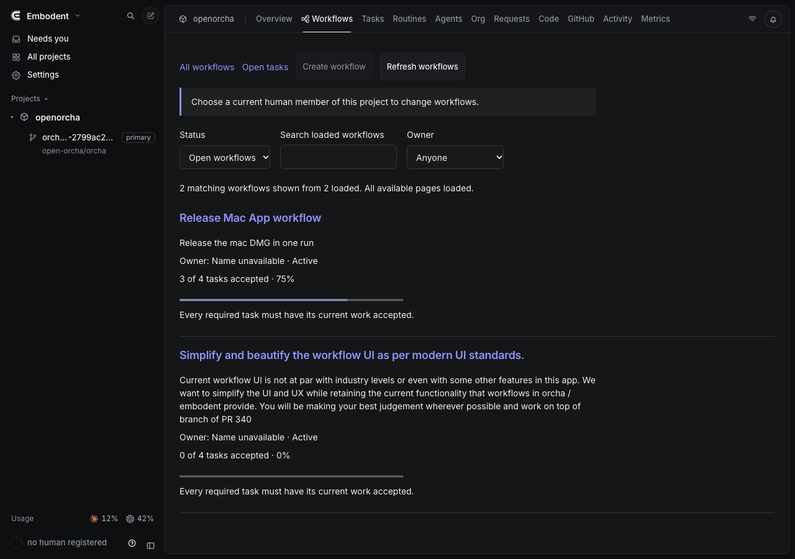
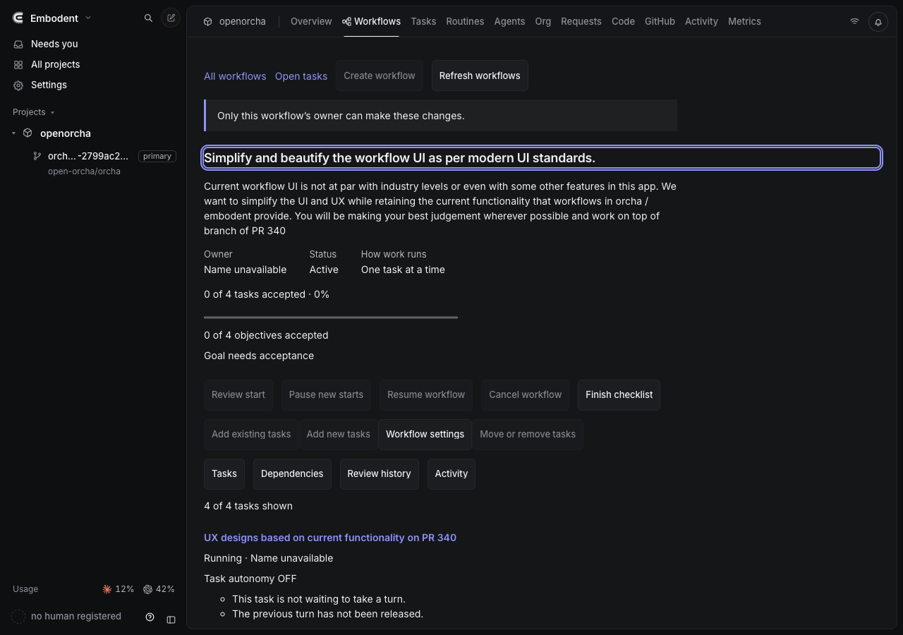

Everything behind the pages is sound: server-derived labels, blockers, `available_actions` with reasons, impact previews, receipt-first recovery, immutable evidence. **This redesign changes presentation and information architecture only.** Every current control keeps a home (§6).

## 2. Principles

1. **Reuse the V2 system as is.** Tokens, Button, IconButton, FilterPills/FilterBar, Toolbar, SplitPane, Inspector, List/Row, StatusIcon, Chip, Badge, Avatar/AvatarStack, PropertyRail/PropertySection/Property, Tabs, Segmented, Section, Timeline, Dialog/ConfirmDialog, Menu/MenuButton, EmptyState, Skeleton, GroupHeader. No new tokens, no new colours, no new icon set.
2. **Retain 100 percent of functionality.** Nothing the server offers disappears; every disabled action stays visible with the server's reason.
3. **One primary action at a time.** The workflow header shows the single next owner action; everything else is in a menu.
4. **Progressive disclosure.** Blockers, dependencies, evidence and history are one click away, not stacked on the page.
5. **Server truth only.** Status icons, chips and copy render `display_state`, `blockers`, `available_actions`, impact previews and evidence states verbatim. No client-side inference. Where a label today is a full sentence, the sentence moves to a tooltip, a sub-line or the inspector; it is never dropped.
6. **Same keyboard and accessibility behaviour as the Tasks page**: roving row focus, Enter/Space to open, Escape to close the inspector or dialog, focus return, 44 px targets on coarse pointers, status never by colour alone.

## 3. Information architecture

Routes are unchanged: `/workflows`, `/workflows/new`, `/workflows/{wid}?tab=tasks|dependencies|review|activity`, the `#workflow-task-{tid}` hash (now opens that task's inspector), and `/tasks?task={tid}&workflowReturn=…`. Query state (`status`, `search`, `owner`, `tab`, `addTask`) and the list-return navigation state stay as they are. The Embodent desktop app embeds the same routes (`desktop/src/renderer/src/host/projectModel.ts` nav entry); nothing desktop-specific changes.

```
Shell page="workflows"  primaryAction = "New workflow"  toolbar = <WorkflowsToolbar> (list only)
└─ /workflows                 list: FilterBar(pills · search · owner · refresh) → grouped List/Row → Load more
└─ /workflows/new             create page: Goal · Objectives · Tasks · Review and save
└─ /workflows/{wid}           detail: header (title · meta · goal · primary action · ⋯ menu · refresh)
                               ├─ Tabs: Tasks | Dependencies | Review history | Activity
                               ├─ SplitPane: tab content | task Inspector (when a task is selected)
                               └─ PropertyRail (≥ 1200 px): properties · objectives · finish blockers
└─ /tasks?task={tid}          task page delta: Workflow section · Task authority switch · Back-to-workflow crumb
```

### Status glyphs (one glyph set, `StatusIcon`)

| Workflow label (`workflowLabel`) | StatusIcon status | Task row (`task.status` + `display_state`) | StatusIcon status |
|---|---|---|---|
| Preparing (`active` and not `launch_enabled`) | `pending` (dashed) | Draft (`preparation_state: draft`) | `ready` (empty circle, faint) |
| Active | `in_progress` | Waiting for its turn / for a prerequisite / held | `pending` (dashed) |
| Paused | `paused` | Running / Stopping | `in_progress` |
| Ready to finish (`completion.can_finish`) | `needs_verification` (review ring) | Awaiting your acceptance (`needs_verification`) | `needs_verification` |
| Completed | `completed` | Accepted (`completed`) | `completed` |
| Cancelled | `cancelled` | Withdrawn / cancelled | `cancelled` |
| | | Released without stop confirmation (`list_warning`) | glyph of the status + warn chip "Warning" with the server text |

The visible label next to the glyph is always the server's `display_state.label` (tasks) or `workflowLabel()` (workflows), exactly as `WorkflowTaskStatus` does on the Tasks page today.

## 4. Screens

### 4.1 Workflows list — frame 01

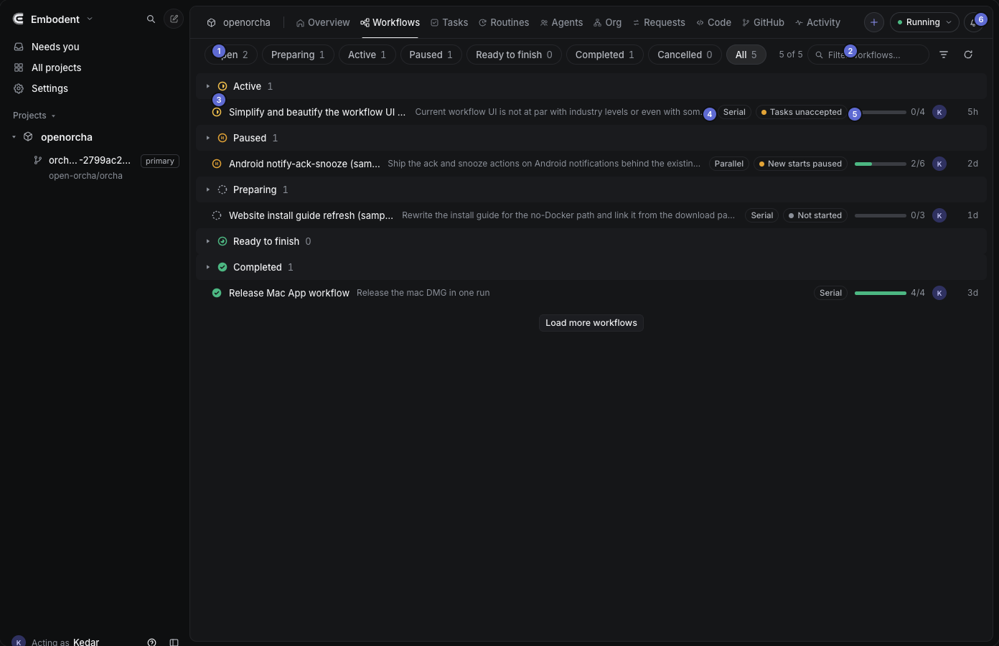

1. **Filter pills** in the Shell toolbar slot (`FilterPills`): Open · Preparing · Active · Paused · Ready to finish · Completed · Cancelled · All, each with its count from the loaded pages. Same filter semantics as today (`open` = active or paused; `preparing` = active and not launch-enabled; `ready` = active and `can_finish`; the server receives `status=active|paused|completed|cancelled` as today). URL state `?status=`.
2. **Search and owner** in the toolbar end slot: "Filter workflows…" (client-side over loaded pages, `?search=`), the owner filter behind the filter icon button (radio list with avatars, `?owner=`), and refresh (resets the cursor, re-reads). The "N of M" count sits next to the search, like the Tasks toolbar.
3. **Grouped rows** when "All" is selected (`GroupHeader` per status, sticky, collapsible); flat rows for any single status.
4. **Row** = `Row` primitive at 36 px: status glyph + label tooltip · title (450 weight) · goal (muted, one line, full text on hover) · chips · progress · owner avatar · age. Enter opens the detail; focus is restored to the row on return (`workflowListFocus`), as today.
5. **Chips and progress**: mode chip ("Serial" / "Parallel", tooltip gives the long explanation), the first completion blocker as a warn-dot chip (full message in the tooltip), 72 px progress bar with `accepted/total` (fill colour = `--v2-status-done`; "No tasks yet" and "Task progress unavailable" render as muted text in place of the bar, exactly the cases `WorkflowProgress` handles today).
6. **New workflow** is the Shell `primaryAction`; disabled with the `workflowWriteReason` tooltip when the viewer cannot write.
7. **Load more** stays a secondary button under the last group when `next_cursor` is set; the "search and owner filters apply to loaded pages" note becomes the tooltip of the count.

### 4.1b List states — frame 01b

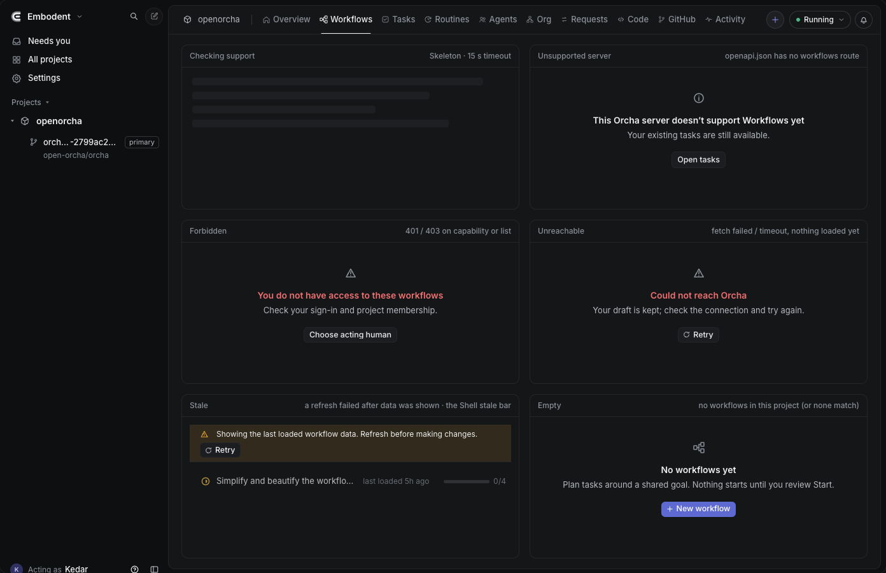

Same panel, same toolbar; the state replaces the list body only. Checking support → `Skeleton` (15 s timeout as today). Unsupported server → `EmptyState` with "Open tasks". Forbidden (401/403) → `EmptyState tone="danger"` with "Choose acting human". Unreachable with nothing loaded → danger EmptyState with Retry. A failed refresh after data was shown → the Shell stale bar above the dimmed list ("Showing the last loaded workflow data. Refresh before making changes." + Retry) and every write control disabled. Empty → neutral EmptyState with "New workflow". "Choose a project to view Workflows" (no `cid`) keeps its sentence as an EmptyState title.

### 4.2 Workflow detail — frame 02

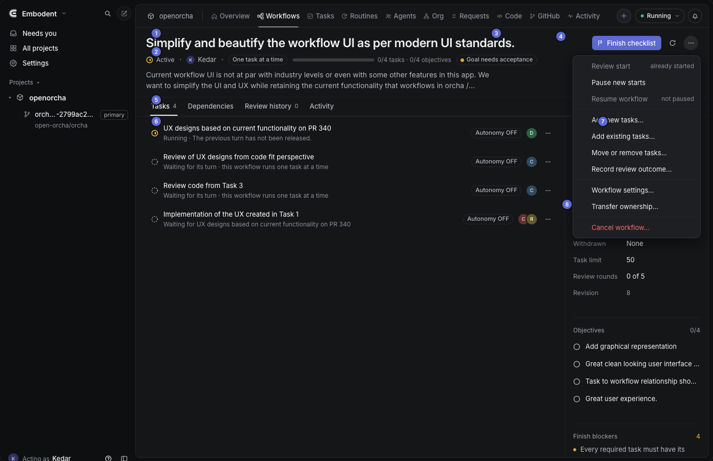

1. **Title** at `--v2-fs-display`, focus target on arrival (replaces the focused `<h2>`), never clamped.
2. **Meta row**: status glyph + label · owner avatar + name · mode chip (tooltip: the long "Tasks with dependencies take their turn alone…" sentence) · 160 px progress with "accepted/total tasks · accepted/total objectives" · goal-acceptance chip (warn dot "Goal needs acceptance" / ok dot "Goal accepted"). Replaces the `<dl>` summary.
3. **Goal** as a two-line clamp with the full text in the tooltip and in the rail.
4. **Primary action + overflow**: ONE primary button = the first *enabled* of Review start → Resume workflow → Finish checklist; when none is enabled the primary is still "Finish checklist" (the checklist stays discoverable for readers, as today). The ⋯ menu lists every other workflow action in fixed order: Review start · Pause new starts · Resume workflow | Add new tasks… · Add existing tasks… · Move or remove tasks… · Record review outcome… | Workflow settings… · Transfer ownership… | Cancel workflow… (danger). Disabled items show the server reason as the menu hint and tooltip (`actionReason`). Refresh is the circular icon button next to it. While an operation is sending or uncertain, every item is disabled and the notice (§4.4) shows.
5. **Tabs** (`Tabs` primitive, `?tab=`): Tasks (count) · Dependencies · Review history (count of rounds) · Activity.
6. **Task rows** (two-line `Row`): status glyph · title · sub-line = `display_state.label` + the first blocker message (every blocker is in the inspector) · chips: "Autonomy OFF/ON", a warn chip when `list_warning` is set · assignee avatar(s) (dashed circle = unassigned) · row ⋯ menu with the task's enabled `available_actions`. Withdrawn tasks render dim with a "Withdrawn by {name}" sub-line. "Release lost worker becomes available at {time}" renders as the sub-line while `release_available_at` is set.
7. **Property rail** (≥ 1200 px): Owner · Status · How work runs · Tasks · Objectives · Goal · Withdrawn count · Task limit · Review rounds `used of limit` · Revision; an Objectives section with one row per objective (glyph = accepted or not); a Finish blockers section listing `completion.blockers` with task links.
8. **Overflow menu open** (shown): the Popover/Menu primitive, `placement="bottom-end"`, `--v2-z-popover`.

### 4.3 Task inspector — frame 03

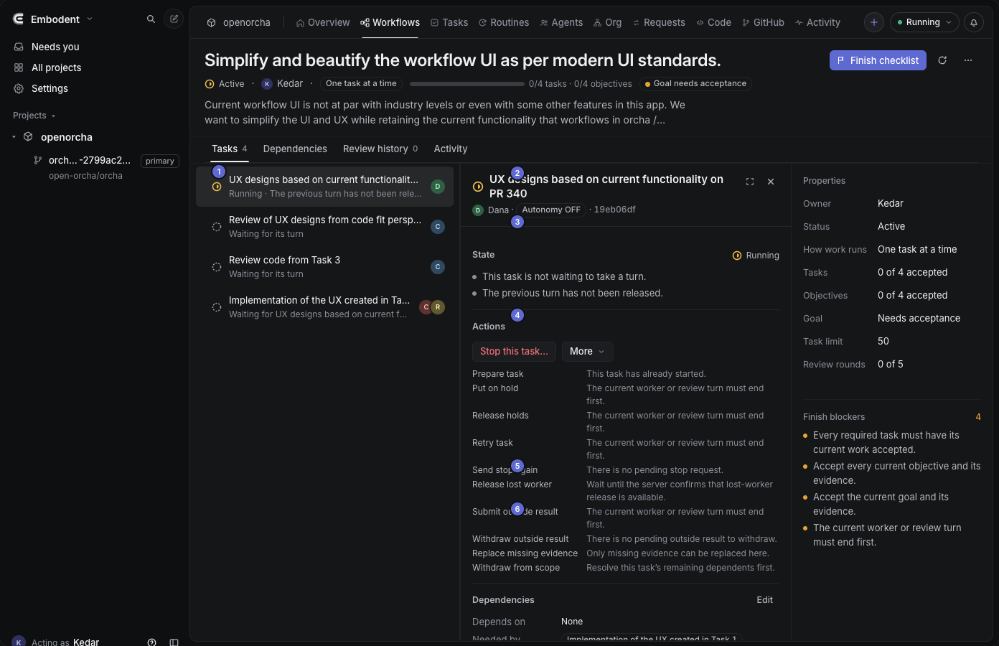

Replaces the "Manage {task}" dialog. Opens on row activation or `#workflow-task-{tid}`; Escape closes and returns focus to the row; the expand icon opens the task page.

1. Selected row (`is-selected`).
2. **Inspector header**: status glyph + title (`.v2-inspector-title`, clamps to 3 lines), meta line = assignee avatar · autonomy chip · short id.
3. **State**: the label on the right, every `blockers[].message` as a list; `display_state.warning` as a warn item; the release-available time line when set.
4. **Actions**: enabled `available_actions` as buttons — primary group (Prepare task, Retry task / Let worker start, Release holds, Review result…) as secondary buttons, Stop this task / Withdraw from scope as danger buttons, everything else enabled behind "More ▾". Under them, **Not available now**: every disabled action with its server reason (`availableActionReason`), so nothing is hidden. "This action is not supported by this portal version yet" (route missing from `workflowRoutes`) is listed the same way.
5. **Dependencies**: Depends on / Needed by as task chips (link to the task page with `workflowReturn`); "Edit" opens the dependency editor (§4.8, callout 5).
6. **Acceptance**: `WorkflowTaskAcceptanceRecord` content as a compact record (accepted by · kind · work revision · time · autonomy at acceptance · authority sentence · supplier lines · same-person note · attribution-unavailable warning · accepted files with storage state and a "Fingerprint" disclosure · acceptance source disclosure). **Saved evidence**: `WorkflowEvidencePanel` as evidence cards (Current/Earlier badge · result and work revision · Saved/Pending/Missing/Superseded badge · "Attempt record" note · files as version links with the sha256 short hash · source and snapshot phase · submitter · incomplete-evidence warning) with Refresh and "Load earlier evidence". The diagnostics footnote stays as muted text.
7. **Task authority**: one line (ON/OFF, what it means) linking to the task page where the owner changes it.

### 4.4 Action dialogs — frames 04 and 04b

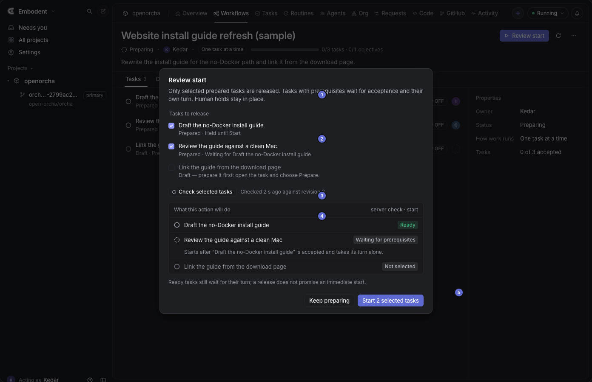
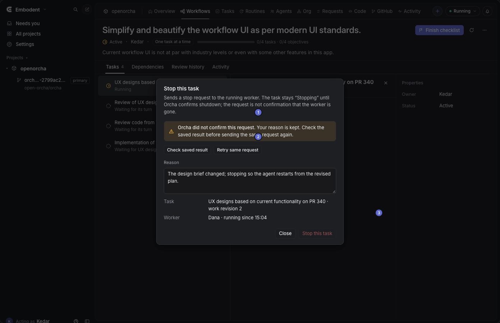

One `Dialog` pattern for all 17 workflow and task actions: title = the action, description = the current one-paragraph explanation, inputs, a **Check** step that calls the server check route, the **impact card** ("What this action will do", one row per task: title · resulting status as a Badge · refusal or blocker lines), then confirm. The confirm button is primary, or danger for Stop, Cancel, Withdraw, Withdraw outside result, Release lost worker; it stays disabled until the check matches the current inputs (`impactMatches`), and a refusal clears the preview so the person must check again (unchanged logic).

1. Review start: the "Tasks to release" choice list (prepared tasks checkable, draft tasks disabled with "prepare it first"), "Remove unavailable selections" appears as a ghost button when a choice became ineligible, "All required tasks are already accepted…" as the description when applicable.
2. Check selected tasks (`GET /start-check?task_ids=`), with "checked N s ago against revision R".
3. Impact card rows: Ready · Waiting for prerequisites · Takes its turn alone · Still blocked · Unchanged · Cannot release (+ refusal message).
4. Footer: "Keep preparing" / "Start N selected tasks".
5. **Operation notice** (04b): the `WorkflowOperationNotice` states as a banner at the top of the dialog body — sending ("Saving… keep this page open"), uncertain (warn banner + "Check saved result" / "Retry same request"), refused (danger banner with the server message; typed drafts are kept). While sending or uncertain the confirm button is disabled and the dialog cannot be dismissed, as today. The same banner appears under the detail header when a dialog was closed with an operation still unresolved.

Inputs per action (unchanged fields, new layout):

| Action | Inputs | Check route | Confirm |
|---|---|---|---|
| Review start | task choices | `GET /start-check` | Start selected tasks |
| Pause new starts / Resume workflow | — | fresh detail | Pause new starts / Resume workflow |
| Cancel workflow | reason (required) | `GET /cancellation-check` → counts by state · accepted results kept · workers to stop | Cancel workflow (danger) |
| Finish checklist | §4.6 | `GET /completion-check` | Finish workflow |
| Prepare task | Done when · assignee | fresh detail | Prepare task (description notes when preparing also releases the start hold) |
| Put on hold | reason | fresh detail | Put on hold |
| Release holds | hold choices (start · human: reason) | `GET /release-check?task_ids=&holds=` | Release holds |
| Retry task / Let worker start | reason · reassign (optional) | fresh detail | Retry task |
| Stop this task / Send stop again | reason | fresh detail | danger |
| Release lost worker | reason · "I understand the worker may still be running" | fresh detail; enabled only when `release_available` | danger |
| Withdraw from scope | reason | fresh detail | danger |
| Edit dependencies | prerequisite choices (3 max, reasons inline) | fresh detail | Save dependencies (`PUT /dependencies`) |
| Submit outside result | result · produced by · evidence | fresh detail | Save outside result |
| Withdraw outside result | reason | fresh detail | danger |
| Replace missing evidence | evidence | fresh detail; only when `evidence_state: missing` | Save evidence |
| Add new tasks | task cards (§4.7) | `WorkflowChange` review | Confirm task addition |
| Add existing tasks | §4.7b | `POST /import-preview` | Confirm addition |
| Move or remove tasks | task choices · destination (active workflows, "Load more") · reason; "Include the whole group" | fresh source + destination detail | Confirm task move |
| Workflow settings | name · goal · mode (Segmented) · task limit · round limit · reason; Objectives editors as disclosures (title · criteria · reason, current vs proposed) | `WorkflowChange` (mode change requires paused + no live turn) | Confirm settings change |
| Transfer ownership | new owner (humans, MenuButton with avatars) | `WorkflowChange` | Confirm ownership transfer |
| Record review outcome | review sequence · review task · reviewed task · evidence pick · outcome · optional correction + follow-up pair | `WorkflowChange` | Confirm review outcome |
| Resolve findings | reason | `WorkflowChange` | Confirm owner resolution |

### 4.5 Result review — frame 05

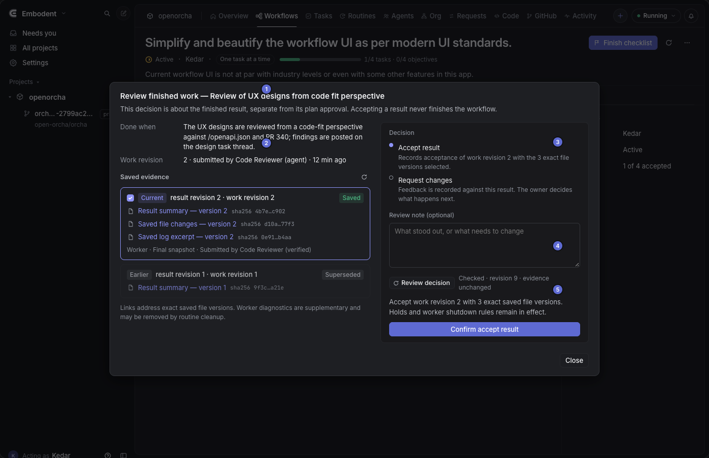

Opens from "Review result…" in the inspector (and from the row menu) for a task in `needs_verification`; a wide dialog so result and decision sit side by side.

1. Title names the task; description = "This decision is about the finished result, separate from its plan approval. Accepting a result never finishes the workflow."
2. Left: Done when · work revision and submitter · **Saved evidence** cards; the current set carries the "Use current saved evidence" checkbox (required for Accept); pending/missing/changed states render as the warn banner with the existing copy.
3. Right: Accept result / Request changes radios with one-line consequences; note field (label switches to "What needs to change" for reject).
4. "Review decision" re-reads the detail and the evidence set (unchanged guards) and shows what was checked.
5. Confirm (primary for accept, danger for request changes) with the existing preview sentence. The supplier line ("Result supplied by {alias}…") shows above the confirm when an outside/owner result is involved.

### 4.6 Finish checklist — frame 06

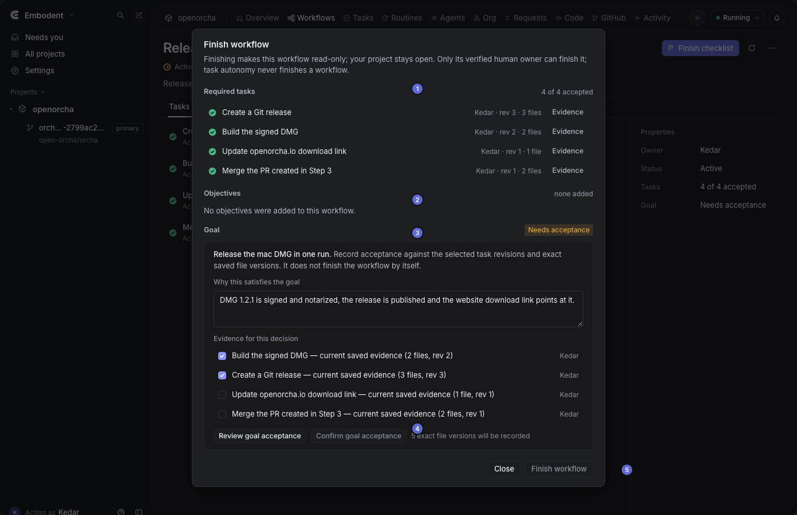

1. **Required tasks**: one row per task with its acceptance glyph, who accepted, work revision, file count, and an "Evidence" ghost button that expands that task's acceptance record inline (replaces the "Inspect a task's saved evidence" select).
2. **Objectives**: rows with Accepted / Needs acceptance; an unaccepted objective expands into the acceptance form (narrative · evidence picks per task · Review · Confirm) — the `WorkflowAcceptance` + `WorkflowEvidenceBasis` flow.
3. **Goal**: the same form for the goal when `goal_accepted_revision !== goal_revision`.
4. The acceptance form's "N exact file versions will be recorded" line and the "Objective and goal acceptance are separate recorded steps before Finish" note.
5. **Still blocking Finish**: `completion.blockers` with task links; same-person acceptances ("N owner-supplied results accepted by the same person" + View), attribution-unavailable and evidence-capability-unavailable notices render here as warn items. Footer: Close / Finish workflow, enabled only when `can_finish` and the evidence capability is available; tooltip carries the first blocker.

### 4.7 Create workflow — frame 07

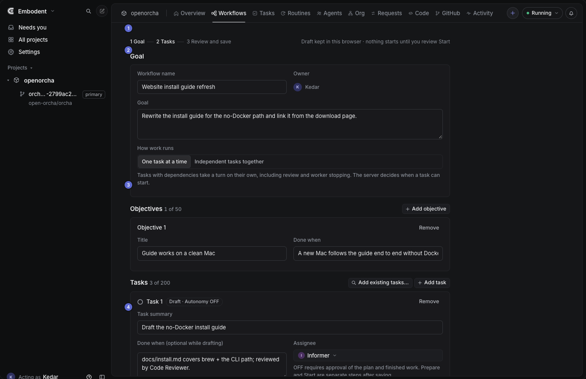

Stays a full page (`.wf-create`, 760 px), draft kept in session storage per project and person as today.

1. Stepper line (Goal · Tasks · Review and save) and the "Draft kept in this browser · nothing starts until you review Start" note (replaces the top notice paragraph). While an original save is being checked the whole form is disabled with "Checking the original save…".
2. **Goal card**: name · owner · goal · How work runs as a `Segmented` control with the explanation as a muted line.
3. **Objectives** (0–50) as cards with Title / Done when and Remove; **Tasks** (1–200) as cards: status glyph "Draft · Autonomy OFF" chip, summary, Done when, assignee `MenuButton` (avatars), the autonomy explanation as a muted line, **Depends on** as a chip picker ("Add prerequisite" opens a menu of the other draft and selected existing tasks; disabled entries carry `dependencyReason`: 3-max, cycle, self), Instructions behind a disclosure, Remove (disabled with "Change dependents first" when other tasks depend on it). "Add existing tasks…" opens §4.7b and selected existing tasks appear as chips under Tasks.
4. **Review and save**: "Review draft" → the draft problems list or the checked summary card (blockers, import impact, finished-result reviews when existing tasks are included); "Save workflow" primary, enabled only after a clean review; "Discard draft…" ghost with the existing ConfirmDialog; after saving, the "Workflow saved · Open saved workflow" line.

### 4.7b Add existing tasks — frame 07b

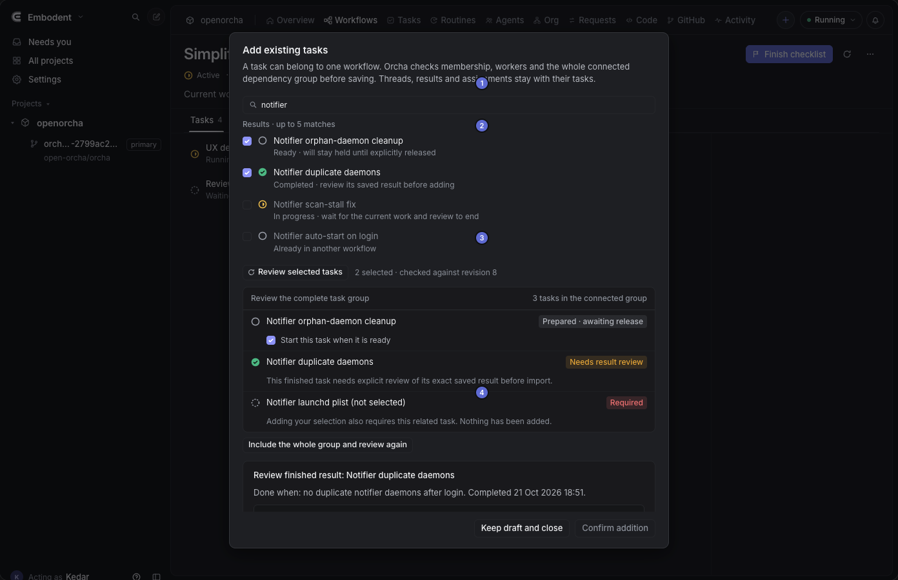

1. Server search (`/workflow-task-search`, 5 matches, 200 ms debounce) with the selected tasks kept above the results; each row shows the task's status glyph and the reason/note (already in this/another workflow, project objective, wait for current work, retry first, review its saved result, will stay held).
2. "Review selected tasks" → `POST /import-preview`.
3. **Impact card**: group size, one row per task (Draft / Prepared · awaiting release / Cannot be added / Needs result review / Required), hold retained, "Start this task when it is ready" checkboxes when the workflow has started, and "Include the whole group and review again" when required tasks are missing. "Remove unavailable start choices" appears when a saved start choice is no longer valid.
4. **Review finished result** cards for completed tasks (done when · description · saved result · completed at · narrative · "I accept this saved result"), unchanged fields. Footer: Keep draft and close / Confirm addition.

### 4.8 Dependencies — frame 08

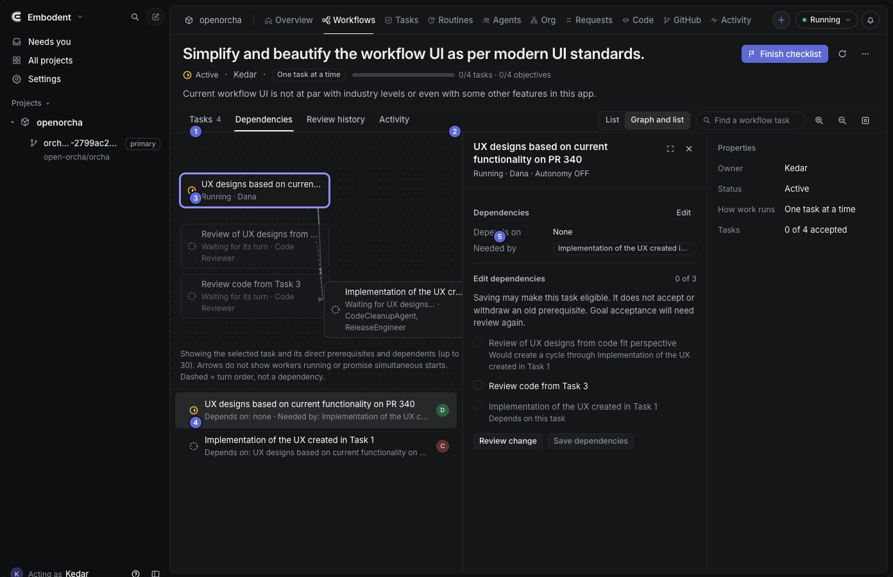

1. Tab actions: List / Graph and list `Segmented`, "Find a workflow task" search, zoom in / out / fit as icon buttons (reset = fit at 1×).
2. Selecting a node or a row opens the task inspector, replacing the "Selected task" select and the selection notice; "Reset selection" is the inspector's close.
3. **Graph**: nodes are task rows (glyph · title · state · assignee), the selected node ringed, neighbours at full opacity, others dimmed; solid arrows = `depends_on` (prerequisite → dependent); the explanatory sentences become the muted caption. Still an explanatory diagram: no drag editing, keyboard users use the list.
4. **List**: the same rows as the Tasks tab with "Depends on · Needed by" as the sub-line.
5. **Edit dependencies** lives in the inspector as a section (choices with reasons, 3-max counter, Review change / Save dependencies).

### 4.9 Activity and Review history — frames 09 and 09b

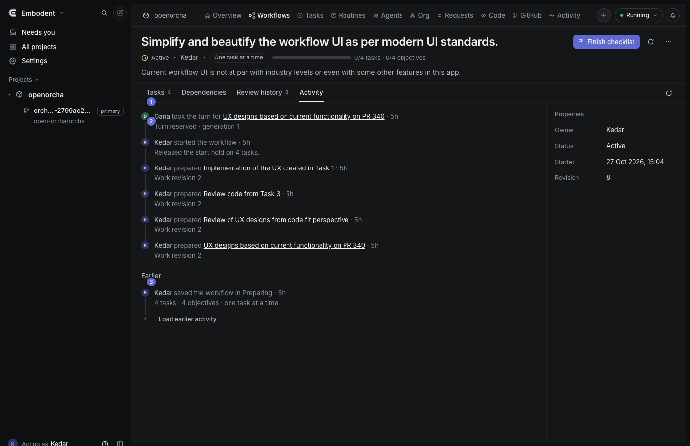
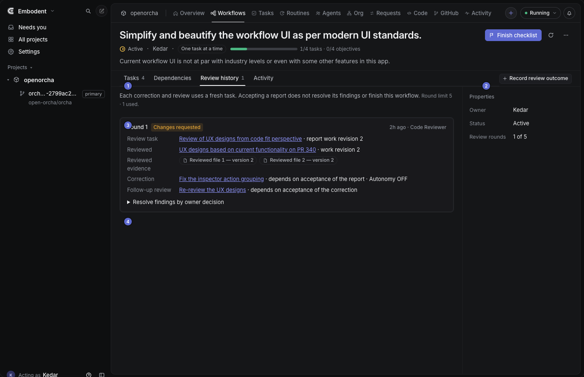

Activity: the `Timeline` primitive; each entry = actor avatar · actor · event label (`eventLabel`) · task link · relative time with the absolute time in the tooltip; reason, warning (warn), supplier and same-person lines as the body. Refresh in the tab row; "Load earlier activity" as the last row; the error + "Retry history" and "Showing previously loaded activity" states as the stale bar.

Review history: intro sentence with "Round limit N · used M"; one `TimelineCard` per round (outcome Badge, review task + report revision, reviewed task + revision, reviewed evidence files as chips, correction and follow-up tasks, "Resolved by owner decision: reason" when resolved, otherwise the "Resolve findings by owner decision" disclosure with reason + Review/Confirm). "Record review outcome" in the tab actions. "Limit reached — no new starts" as a warn banner; "Review history is unavailable on this server version" as an EmptyState.

### 4.10 Task page delta — frame 10

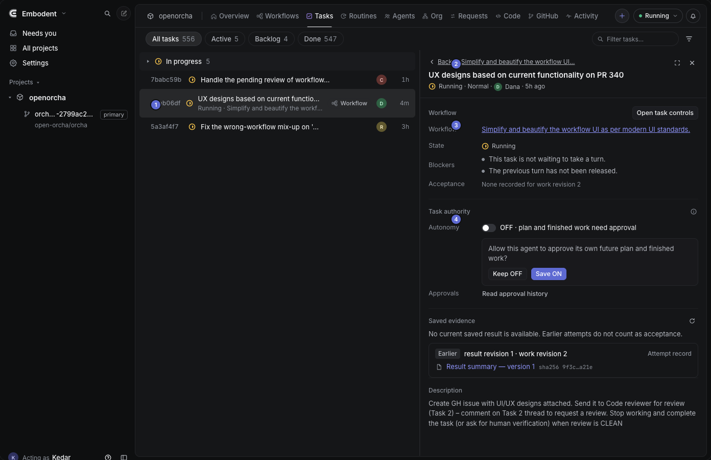

Only the workflow-related parts of `TaskDetail` change:

1. Task rows of workflow members: `WorkflowTaskStatus` glyph, the server label and workflow title as the sub-line, a "Workflow" chip (instead of "{title} · Autonomy OFF" squeezed into the chip).
2. The "Back to {workflow}" crumb above the title (`WorkflowTaskReturn`).
3. **Workflow** property section: workflow link, state (glyph + label, "(last loaded)" when stale), blockers, warning, release-available time, acceptance summary, "Open task controls" button (→ the workflow page with the inspector open). The membership-loading and error states render as a muted line and the stale bar; "Refresh task workflow" is the section's refresh icon. For non-members, `WorkflowTaskEntry` becomes a "Workflow membership…" item in the task's ⋯ menu opening the existing dialog (as a list of "Add to {workflow}" rows with reasons and "Create workflow with this task").
4. **Task authority**: Autonomy as a labelled switch (`role="switch"`) with the one-line meaning; flipping it shows the existing confirmation card (Keep / Save) — the server rule is unchanged (owner only, not for root or finished tasks, membership checked first); "Check current setting" appears after an uncertain save; "Read approval history" lists plan and finished-work approvals as timeline rows with the permission source and fingerprints behind a disclosure. The explanatory paragraphs move to the (i) help mark.

### 4.11 Responsive — frames 11 and 12

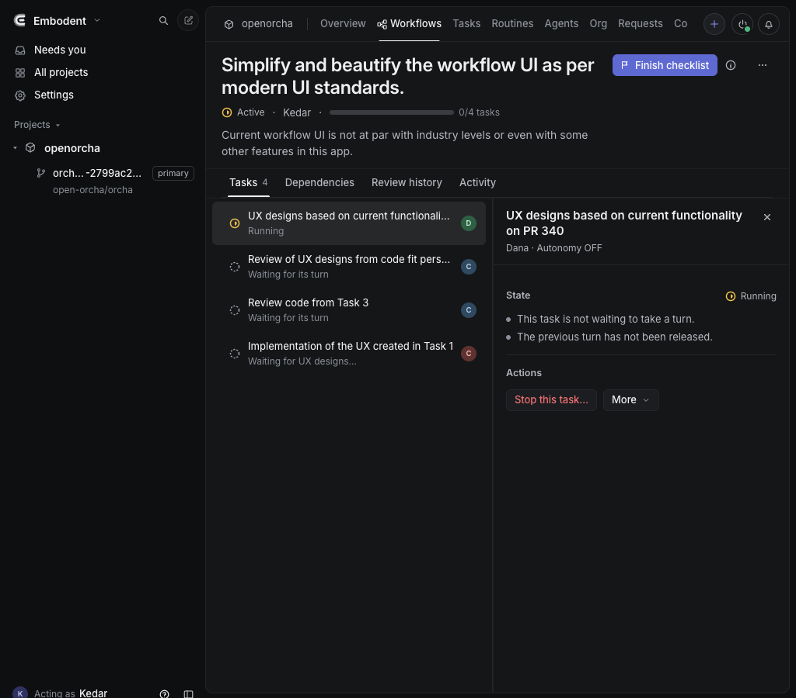 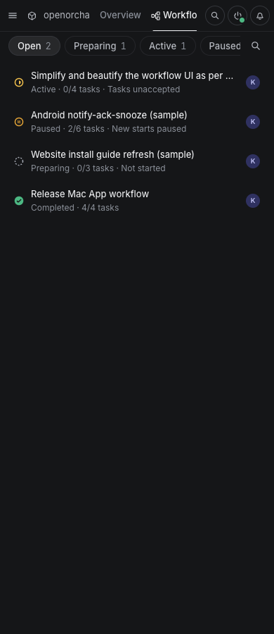

- ≥ 1200 px: tab content · inspector · rail (three columns).
- 720–1200 px: the rail folds into a "Details" icon toggle in the header (opens the same rail as a popover); list and inspector share the pane (inspector ≥ 380 px).
- < 720 px: the Shell's drawer rules apply; rows are full width at 44 px; goal and age columns drop; opening a task replaces the list with the inspector and a Back control; dialogs become full-height sheets (the Dialog primitive's existing behaviour).

## 5. Component mapping

| Today (`pages/workflows`) | Redesign |
|---|---|
| `wf-actions` nav links + Refresh | Shell `primaryAction` (New workflow) + toolbar refresh icon / detail header refresh icon |
| `wf-filters` three `<select>`s + count sentence | `FilterPills` + search input + owner filter Popover + `wf-filtercount` |
| `wf-task-list` `<li>` with `<h2>` + `<p>` | `List` + `Row` (36 px, two-line variant) |
| `WorkflowProgress` `<progress>` + sentence | `.wf-prog` bar + `accepted/total` (same guards) |
| `WorkflowSummary` `<dl>` | `.wf-head` title / meta row / goal + `PropertyRail` |
| `WorkflowActions` five buttons | one primary + `Menu` |
| `WorkflowImport`, `WorkflowAddTasks`, `WorkflowSettings`, `WorkflowMove`, `WorkflowReviewEditor` buttons | items in the same `Menu`; their dialogs keep their fields on the V2 form controls |
| tab `Button`s with `aria-pressed` | `Tabs` |
| `WorkflowTaskActions` "Manage" button + dialog | row ⋯ `Menu` + `Inspector` (Actions section) + per-action `Dialog` |
| `WorkflowTaskDecision` inline form | the Result review dialog |
| `WorkflowEvidencePanel` / `SavedEvidence` headings + `<ul>` | evidence cards (`.wf-evi`) with `Badge`s |
| `WorkflowTaskAcceptanceRecord` paragraphs | Acceptance section in the inspector / checklist rows |
| `WorkflowImpactView` headings + `<ul>` | impact card (`.wf-impact`) with status `Badge`s |
| `WorkflowOperationNotice` `wf-notice` box | `.wf-opnotice` banner (warn / danger) |
| `WorkflowDependencies` selects + `<svg>` boxes | `Segmented` + search + zoom icon buttons; nodes as rows; inspector for selection |
| `WorkflowActivity` `<ol>` | `Timeline` / `TimelineEvent` |
| `WorkflowReviewHistory` `<ol>` | `Timeline` / `TimelineCard` |
| `WorkflowDraftEditor` fieldsets | cards (`.wf-card`), `Segmented`, `MenuButton`, chip picker |
| `WorkflowTaskInspector` paragraphs on the task page | `PropertySection` "Workflow" |
| `TaskAuthority` text + "Change to" button | `role="switch"` + confirmation card |
| `<p role="status">` / `<p role="alert">` states | `Skeleton`, `EmptyState`, Shell stale bar, dialog banners |
| `workflows.css` (960 px column) | the page CSS in `redesign.html` `<style>` (tokens only, flush panel layout) |

## 6. Functionality retention matrix

Every control on the PR #340 pages and where it lives in the redesign. "Same" = same field, same validation, same request.

| Current control | New home |
|---|---|
| All workflows / Open tasks links | Project tabs (Workflows / Tasks) already in the Shell header; "Open tasks" also in the unsupported-server EmptyState |
| Create workflow (+ write-reason disable) | Shell primary action, same disable + tooltip |
| Refresh workflows | toolbar refresh icon (list), header refresh icon (detail) |
| Status select (8 options) | filter pills, same mapping |
| Search loaded workflows / Owner select | toolbar search / owner Popover |
| "N matching shown from M loaded… more available" | `N of M` count + tooltip |
| Load more workflows | same button |
| Checking / unsupported / forbidden / unreachable / stale / loading / empty / no-project sentences | §4.1b states |
| Row title, goal, owner, label, progress, first blocker | row columns and chips (§4.1 callout 4–5) |
| Summary: name, goal, owner, status, mode, task and objective progress, goal label, withdrawn count | header meta + rail |
| Review start / Pause / Resume / Cancel / Finish buttons and reasons | primary action + menu with reasons (§4.2 callout 4) |
| Start dialog: explanation, remove unavailable selections, all-accepted note, task checkboxes with label + blockers, "needs a fresh check", Check selected tasks, impact | §4.4 callouts 1–4 |
| Pause / Resume explanations | dialog descriptions |
| Cancel: explanation, impact (counts by state, accepted retained, workers to stop), reason | Cancel dialog (impact card with three groups) |
| Finish: progress sentence, goal + status, objectives list, blockers with task links, same-person note + View, attribution unavailable, saved evidence records, inspect-a-task select, evidence capability note, separate-steps note, Review objective / Review current goal, can_finish line, read-only note | §4.6 |
| Operation notice: sending / uncertain (Check saved result, Retry same request) / refused message | banner (§4.4 callout 5) |
| Add existing tasks: search, selected group, results with reasons/notes, Review selected tasks, group impact, start-when-ready, blockers, include whole group, remove unavailable start choices, finished-result review, Keep draft and close / Confirm addition | §4.7b |
| Add new tasks: intro (started/not), task fields, dependency choices with reasons, remove rules, Add task summary, review + confirm | menu item → dialog with the create-page task cards |
| Workflow settings: intro, name/goal/mode/limits/reason, mode-change guard, objective editors, transfer ownership | Settings dialog (Segmented mode, objectives as disclosures); Transfer ownership also as its own menu item opening the same section |
| Move or remove tasks: intro, task choices with reasons, destination select + Load more, reason, include whole group, review, impact, confirm | Move dialog |
| Tabs Tasks / Dependencies / Review history / Activity | `Tabs` |
| Task list count line | tab count |
| Task row: title link, label · assignee, withdrawn line, autonomy line, reasons, depends on / needed by, release time, stop warning | row sub-line and chips; full detail in the inspector (§4.3) |
| Manage dialog: label, blockers, warning, release time, acceptance record, decision form or evidence panel, 12 actions with reasons, autonomy copy, error / busy, Refresh task review, action forms | inspector sections + per-action dialogs; "Refresh task review" = the dialog's Check step |
| Dependencies: List / Graph toggle, find, selected task, selection notice, Open selected task, Reset selection, arrows note, graph count, zoom in / out / fit / reset, SVG nodes, list | §4.8 |
| Review history: intro, rounds (outcome, links, revisions, files, resolved line), Resolve findings (reason + review/confirm), limit reached, Record review outcome dialog | §4.9 |
| Activity: refresh, error + retry, stale note, loading, empty, entries, Load earlier | §4.9 |
| Evidence panel: title, loading / error, Refresh, no current result, pending / missing warning, Use current saved evidence, sets with items / links / storage state / source / submitter / incomplete note, Load earlier evidence, diagnostics footnote | evidence cards (§4.3 callout 6, §4.5) |
| Acceptance record: all lines, fingerprints, source | Acceptance section (§4.3 callout 6) |
| Task decision: done when, explanation, radios, note, evidence pick, supplier line, invalid reason, Review decision, preview sentence, Confirm | §4.5 |
| Create page: draft note, frozen note, goal section, objectives, task fieldsets, existing tasks, Review and save, problems, checked summary, import impact + review, save reason, Save, saved link, Discard + confirm | §4.7 |
| Task page: Back to workflow, Workflow membership dialog, status label + "(last loaded)" + Warning, workflow inspector lines, Open workflow task controls, evidence panel, Refresh task workflow, Task authority (mode, copy, blocked reason, Change to, confirm, message, Check current setting, Check task authority), Approval history (unavailable note, Read / Refresh, error, plan + completion records with details) | §4.10 |
| Tasks list row for members: workflow chip, server label under the title | §4.10 callout 1 |

## 7. API check

Every screen renders data and actions already in the live `/openapi.json` (port 8004, PR #340). Routes used, by screen: list `GET /api/containers/{cid}/workflows[/capability]`; detail `GET /api/workflows/{wid}`; checks `GET …/start-check`, `release-check`, `cancellation-check`, `completion-check`; actions `POST …/start|pause|resume|cancel|finish|import|import-preview|move|transfer-owner|review-rounds|review-loops/{tid}/resolve|goal/accept|objectives/{oid}/accept|tasks`, `PATCH …` and `…/objectives/{oid}`, `POST …/release`; tasks `POST /api/tasks/{tid}/prepare|hold|stop|reissue-stop|retry|release-lost-worker|withdraw-from-scope|external-result[/{eid}/withdraw]|accept|reject`, `PUT /api/tasks/{tid}/dependencies`, `PUT /api/tasks/{tid}/autonomy`, `GET /api/tasks/{tid}/approvals`; evidence `GET/POST /api/workflows/{wid}/tasks/{tid}/evidence`; search `GET /api/containers/{cid}/workflow-task-search`; receipts `GET /api/containers/{cid}/workflow-operations/{key}`; activity `GET /api/workflows/{wid}/activity`; create `POST /api/containers/{cid}/workflows/preview` then `POST …/workflows`. The `X-Orcha-Local-Actor` header and `expected_revision` / `expected_work_revision` / idempotency-key semantics are unchanged.

**No new API asks.** Two nice-to-haves that are *not* required: per-status counts for the filter pills come from the loaded pages (as the Tasks page does); a server-side search would replace the client-side "Filter workflows" when it exists.

## 8. States, keyboard, accessibility

- Rows: `role="option"` inside `role="listbox"`, ↑/↓/Home/End via `rowNavKeyDown`, Enter/Space opens, `is-selected` + `aria-selected`.
- Inspector: Escape closes and returns focus to the row (`useFocusReturn`); the expand icon is a real link.
- Dialogs: the `Dialog` primitive (focus trap, Escape, labelled title/description); busy and sending states block dismissal as today.
- Menus: `Menu` primitive, disabled items keep `aria-disabled` and a `title` with the reason.
- Status: glyph + exact label (visible or `.v2-sr`) everywhere; warn/danger banners carry `role="status"` / `role="alert"`.
- Touch: 44 px rows and controls under `(pointer: coarse)` through the existing tokens.
- Light theme: the mockups render with the portal's `[data-theme="light"]` token block; no page CSS branches on theme.

## 9. Build notes for workflow task 4

1. **CSS**: replace `workflows.css` with the `.wf-*` rules in `redesign.html` (tokens only, flush `.wf-page` on `--v2-content-h`, rows share geometry with `tasksListCss.ts` — consider extracting the shared row rules).
2. **`WorkflowsPage.tsx`**: keep the data layer (`workflowRequest`, availability, cursor, stale, actor scope, navigation state) as is; swap the render tree: Shell `primaryAction` + `toolbar`, `FilterPills`, `ListGroup`/`Row` list, `EmptyState`/`Skeleton` states.
3. **Detail**: new `WorkflowHeader` (title, meta, goal, primary + `Menu`), `Tabs`, `SplitPane` with a `WorkflowTaskInspector` that composes the existing `WorkflowTaskActions` logic (reviews, confirms, `useWorkflowForm`, `WorkflowOperationNotice`) with the sections of §4.3; the per-action `Dialog`s reuse the current field components. `WorkflowActions`, `WorkflowImport`, `WorkflowAddTasks`, `WorkflowSettings`, `WorkflowMove`, `WorkflowReviewEditor` become menu-triggered dialogs (their internal logic is unchanged).
4. **Rail**: `PropertyRail` with the values from `detail` and `completion`; hidden < 1200 px behind the header toggle.
5. **Evidence / acceptance / impact**: restyle `WorkflowEvidencePanel`, `WorkflowTaskAcceptanceRecord`, `WorkflowImpactView`, `WorkflowOperationNotice` into the card and banner shapes; no data or guard changes.
6. **Create page**: restyle `WorkflowDraftEditor` sections as cards; `Segmented` for mode; chip picker for dependencies (same `dependencyReason`); `WorkflowImportChoices` moves into the dialog.
7. **Task page**: `WorkflowTaskInspector` → `PropertySection`; `TaskAuthority` → switch + confirmation card; `WorkflowTaskEntry` → task ⋯ menu item.
8. **Tests**: the existing `*.test.tsx` suites cover behaviour, not markup; expect selector updates only. Keep `designSystem.test.tsx` / `a11yCss.test.ts` green (no hard-coded hex, no colour-only status).

## 10. Decisions taken (approved plan, 2026-10-27)

- The per-task "Manage" dialog becomes a task inspector in a split pane, like the Tasks page.
- Create workflow stays a full page with sections, not a dialog.
- Design assets live on a design branch off PR #340 and are embedded in the issue; no PR.
- Result review opens as a wide dialog (two columns) rather than inside the 460 px inspector, so evidence and decision are visible together.
